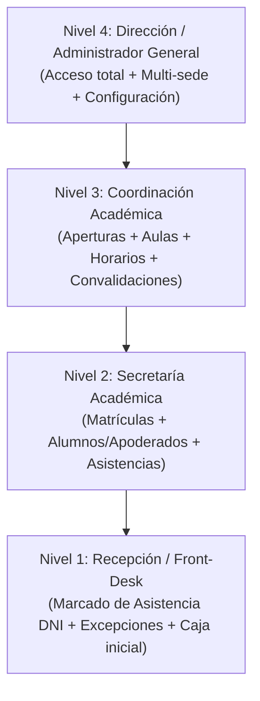

# Modelo de Roles y Permisos de Personal (CETPRO IISEP)

Este documento especifica la estructura y el alcance de los cargos y permisos para el personal administrativo y operativo de **CETPRO IISEP** (Sedes Comas y Puente Piedra).

> **Estado actual:** En fase de boceto / prototipo. El campo `position` en la tabla `staff` se mantiene flexible como texto libre. Este documento sirve como guía formal para cuando se codifique la persistencia de permisos, políticas de autorización (Policies) o directivas de interfaz.

---

## 1. Arquitectura General de Usuarios

El sistema utiliza un esquema **multi-rol polimórfico** centrado en la tabla `users`. Un usuario puede tener uno o múltiples roles simultáneos según las entidades a las que está vinculado:

```text
User (Identidad Base: DNI, Nombres, Correo, Password)
├── Staff (Personal administrativo / operativo del panel)
├── Teacher (Docente / Instructor)
├── Student (Estudiante)
└── GuardianEnrollments (Apoderado / Tutor legal de un menor)
```

Cualquier usuario con un registro activo en `staff` recibe el rol general de acceso al panel administrativo (`/admin`).

---

## 2. Jerarquía Escalonada de Personal Staff

Para la operativa de CETPRO IISEP, los cargos siguen un modelo **jerárquico escalonado (heredado)**: cada nivel superior hereda todas las facultades y permisos de los niveles inferiores.



---

### Detalle por Nivel y Alcance

#### Nivel 1: Recepción / Control de Asistencias
* **Sede:** Asignada a una sede física (`branch_id`).
* **Objetivo:** Agilidad operativa en el ingreso del local y atención front-desk.
* **Permisos y Funciones:**
  * Búsqueda ágil de estudiantes por número de DNI.
  * Marcado de asistencia en la sesión/curso activo correspondiente.
  * Registro de excepciones de asistencia (cuando un alumno asiste a otra sede o en otro turno por motivo justificado).
  * Consultas básicas de horarios y estado de matrícula del alumno.
  * Gestión de caja inicial o recepción de pagos menores (si aplica en puerta).

#### Nivel 2: Secretaría Académica
* **Sede:** Asignada a una sede física (`branch_id`).
* **Objetivo:** Gestión integral del estudiante y formalización de matrículas.
* **Permisos y Funciones:**
  * **Hereda todo el Nivel 1 (Recepción):** Puede marcar asistencias diarias por DNI en su sede.
  * Registro y actualización de fichas de estudiantes y apoderados.
  * Inscripción en carreras técnicas completas, módulos y talleres cortos.
  * Consulta de vacantes en tiempo real por aula y curso.
  * Emisión de constancias de estudio, certificados modulares y carnets.
  * *Restricción:* No altera mallas curriculares ni elimina cursos aperturados.

#### Nivel 3: Coordinación Académica
* **Sede:** Por sede o global según asignación.
* **Objetivo:** Planificación curricular, asignación docente y supervisión académica.
* **Permisos y Funciones:**
  * **Hereda todo el Nivel 2 (Secretaría) y Nivel 1 (Recepción).**
  * Apertura de cursos (`ScheduledCourse`) para ciclos o periodos específicos.
  * Asignación de docentes a materias y horarios.
  * Distribución física de aulas y talleres técnicos (laboratorios de cómputo, cocina, estética).
  * Evaluación y registro de **convalidaciones de materias**.
  * Modificación de estados de matrícula extraordinarios (`retirado`, `convalidado`, `egresado`).
  * Validación y auditoría de excepciones de asistencia entre sedes.

#### Nivel 4: Dirección General / Super Administrador
* **Sede:** Global (`branch_id: null` / sin restricción de sede).
* **Objetivo:** Control total, auditoría institucional y cumplimiento normativo MINEDU.
* **Permisos y Funciones:**
  * **Hereda todos los niveles anteriores sin restricciones de sede.**
  * Alta, baja y edición de personal staff y asignación de cargos.
  * Creación y edición de infraestructura física (Sedes y Aulas).
  * Definición de planes de estudio y carreras técnicas aprobadas por MINEDU/UGEL.
  * Cierres de ciclos académicos y consolidación de actas oficiales.
  * Anulación definitiva de matrículas o transacciones erróneas.

---

## 3. Alcance Territorial por Sede (`branch_id`)

La columna `branch_id` en la tabla `staff` determina el alcance territorial de cada trabajador:

| Valor de `branch_id` | Comportamiento | Cargos Típicos |
|---|---|---|
| `null` | **Acceso Global:** Puede consultar, matricular y gestionar en todas las sedes (Comas, Puente Piedra y futuras). | Administrador General, Director Académico |
| `ID_SEDE` (ej. 1: Comas, 2: Puente Piedra) | **Filtrado Local:** Solo visualiza y opera alumnos, aulas y cursos aperturados pertenecientes a su sede. | Secretaria de Comas, Recepcionista de Puente Piedra |

---

## 4. Hoja de Ruta para Implementación en Código (Futuro)

Cuando se decida hacer rígido este sistema, se implementará en 3 capas:

1. **Enum en Backend (`app/Enums/StaffPosition.php`):**
   ```php
   enum StaffPosition: string
   {
       case DIRECCION = 'direccion';
       case COORDINACION = 'coordinacion';
       case SECRETARIA = 'secretaria';
       case RECEPCION = 'recepcion';
       
       public function level(): int
       {
           return match ($this) {
               self::DIRECCION => 4,
               self::COORDINACION => 3,
               self::SECRETARIA => 2,
               self::RECEPCION => 1,
           };
       }
   }
   ```

2. **Helper Jerárquico en `Staff.php`:**
   ```php
   public function hasMinimumLevel(int $requiredLevel): bool
   {
       return $this->positionLevel() >= $requiredLevel;
   }
   ```

3. **Policies & Middleware de Laravel:**
   * `can('manage-openings')` -> Nivel 3 o superior.
   * `can('manage-enrollments')` -> Nivel 2 o superior.
   * `can('manage-attendance')` -> Nivel 1 o superior.
